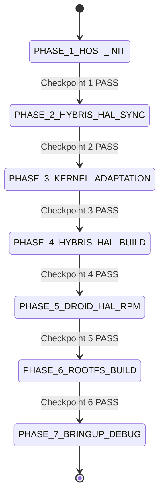
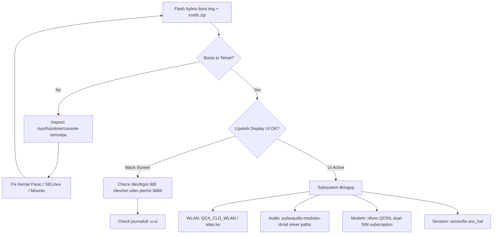

# AGENT_EXEC_SPEC: SFOS_PORT_XIAOMI_LIBRA

```yaml
meta:
  target_executor: "Gemini 3.8 Flash"
  spec_version: "1.0.0"
  protocol: "Dense Technical Shorthand (DTS)"
  execution_mode: "Sequential State-Machine (Autonomous Triage)"
  project_root: "/home/antonio/Projects/sailfish-mi4c"
```

---

## 0. AGENT_IO_CONTRACT & PARSING DIRECTIVES

### Communication Rules
- **DTS Enforcement**: Zero conversational prologue/epilogue. Output only JSON state records or raw patch/command diffs.
- **Token Optimization**: Truncate non-error command outputs to `tail -n 10`. When encountering errors, report exact compiler error or kernel panic lines only.
- **Fail-Fast**: Any non-zero exit code on non-optional commands triggers state `ERR_FATAL` or branches to targeted `ERR_REMEDIATION`.

### State Report JSON Schema
```json
{
  "phase": "PHASE_X",
  "step": "X.Y",
  "status": "IN_PROGRESS | PASS | ERR_FATAL | REMEDIATING",
  "cmd_executed": "<bash_command>",
  "checkpoint": "<checkpoint_id>",
  "stdout_tail": "<last_10_lines_or_error>",
  "remediation_action": null | "<patch_file_or_command>"
}
```

---

## 1. TARGET_DEVICE_PROFILE

| Key | Value | Notes |
| :--- | :--- | :--- |
| **Vendor / Device** | `xiaomi` / `libra` | Xiaomi Mi4c |
| **SoC** | Qualcomm MSM8992 (Snapdragon 808) | 2x Cortex-A57 + 4x Cortex-A53 |
| **Arch** | `aarch64` (ARM64-v8a) | 64-bit kernel & userland |
| **Base Android / Branch** | LineageOS 14.1 (`cm-14.1` / Android 7.1.2) | Branch: `hybris-14.1` |
| **Kernel Source** | `LineageOS/android_kernel_xiaomi_msm8992` | Branch: `cm-14.1` (Linux 3.10.x) |
| **Device Tree** | `LineageOS/android_device_xiaomi_libra` | Branch: `cm-14.1` |
| **Vendor Blobs** | `TheMuppets/proprietary_vendor_xiaomi` | Branch: `cm-14.1` (path: `vendor/xiaomi`) |
| **Display** | 1080x1920 (441 PPI) | Pixel ratio: `2.0` / Compositor DPI: `440` |
| **Sailfish OS Target** | `4.5.0.24` (or `4.6.0.15`) | Architecture: `aarch64` |

---

## 2. GLOBAL_ENV_VARS

Store and export in `~/.hadk.env` and source before any phase:

```bash
export VENDOR="xiaomi"
export DEVICE="libra"
export PORT_ARCH="aarch64"
export ANDROID_ROOT="$HOME/hadk"
export SFOS_REL="4.5.0.24"
export HYBRIS_BRANCH="hybris-14.1"
export SDK_ROOT="$HOME/sailfishos-sdk"
export DROID_LOCAL_REPO="$ANDROID_ROOT/droid-local-repo/$DEVICE"
export USE_CCACHE=1
export CCACHE_DIR="$HOME/.ccache"
```

---

## 3. EXECUTION_PHASES (FINITE STATE MACHINE)



---

### [PHASE_1] HOST_ENV_INIT
**Goal**: Provision host/container with build tools, Platform SDK chroot, and directory tree.

```bash
# 1.1 Directory layout
mkdir -p "$ANDROID_ROOT" "$SDK_ROOT" "$DROID_LOCAL_REPO" "$CCACHE_DIR"
cd "$SDK_ROOT"

# 1.2 Fetch Sailfish OS Platform SDK (Host tooling)
PLATFORM_SDK_URL="https://releases.sailfishos.org/sdk/installers/latest/Jolla-latest-SailfishOS_Platform_SDK_Chroot-i486.tar.bz2"
test -f sdk.tar.bz2 || curl -Lo sdk.tar.bz2 "$PLATFORM_SDK_URL"
sudo tar --numeric-owner -p -xjf sdk.tar.bz2 -C "$SDK_ROOT"

# 1.3 Repo tool verification
mkdir -p "$HOME/bin"
curl -s https://storage.googleapis.com/git-repo-downloads/repo > "$HOME/bin/repo"
chmod a+x "$HOME/bin/repo"
export PATH="$HOME/bin:$PATH"
```

- **CHECKPOINT_1**:
  - Command: `test -f "$SDK_ROOT/sdk-chroot" && repo --version`
  - Assert: Exit code `0`.

---

### [PHASE_2] HYBRIS_HAL_SYNC
**Goal**: Pull `hybris-14.1` Android HAL tree and libra device manifests.

```bash
cd "$ANDROID_ROOT"

# 2.1 Init repo with minimal depth
repo init -u https://github.com/mer-hybris/android.git -b "$HYBRIS_BRANCH" --depth=1

# 2.2 Inject libra local manifest
mkdir -p "$ANDROID_ROOT/.repo/local_manifests"
cat << 'EOF' > "$ANDROID_ROOT/.repo/local_manifests/libra.xml"
<?xml version="1.0" encoding="UTF-8"?>
<manifest>
  <project name="LineageOS/android_device_xiaomi_libra" path="device/xiaomi/libra" remote="github" revision="cm-14.1" />
  <project name="LineageOS/android_kernel_xiaomi_msm8992" path="kernel/xiaomi/msm8992" remote="github" revision="cm-14.1" />
  <project name="TheMuppets/proprietary_vendor_xiaomi" path="vendor/xiaomi" remote="github" revision="cm-14.1" />
</manifest>
EOF

# 2.3 Parallel sync
repo sync -c -j"$(nproc)" --fetch-submodules --no-clone-bundle --force-sync
```

- **CHECKPOINT_2**:
  - Command: `test -f "$ANDROID_ROOT/device/xiaomi/libra/BoardConfig.mk" && test -f "$ANDROID_ROOT/kernel/xiaomi/msm8992/arch/arm64/configs/libra_defconfig"`
  - Assert: Exit code `0`.

---

### [PHASE_3] KERNEL_ADAPTATION
**Goal**: Configure MSM8992 Linux 3.10.x kernel for systemd, cgroups, namespaces, and libhybris.

```bash
cd "$ANDROID_ROOT"
DEFCONFIG="kernel/xiaomi/msm8992/arch/arm64/configs/libra_defconfig"

# 3.1 Enforce mandatory SFOS kernel flags in defconfig
cat << 'EOF' >> "$DEFCONFIG"

# --- Sailfish OS Mandatory Flags ---
CONFIG_CGROUPS=y
CONFIG_CGROUP_FREEZER=y
CONFIG_CGROUP_DEVICE=y
CONFIG_CGROUP_CPUACCT=y
CONFIG_NAMESPACES=y
CONFIG_UTS_NS=y
CONFIG_IPC_NS=y
CONFIG_USER_NS=y
CONFIG_PID_NS=y
CONFIG_NET_NS=y
CONFIG_DEVPTS_MULTIPLE_INSTANCES=y
CONFIG_VT=y
CONFIG_VT_CONSOLE=y
CONFIG_SYSVIPC=y
CONFIG_SECURITY_SELINUX=y
CONFIG_SECURITY_SELINUX_BOOTPARAM=y
CONFIG_SECURITY_SELINUX_DISABLE=y
CONFIG_ANDROID_PARANOID_NETWORK=n
CONFIG_TMPFS_POSIX_ACL=y
CONFIG_SWAP=y
# -----------------------------------
EOF

# 3.2 Verify kernel config against HADK checker
curl -sO https://raw.githubusercontent.com/mer-hybris/hybris-boot/master/verify_kernel_config.sh
chmod +x verify_kernel_config.sh
./verify_kernel_config.sh "$DEFCONFIG" || true

# 3.3 Sanitize rootdir init scripts
# Disable Android-specific conflicting services in device/xiaomi/libra/rootdir:
sed -i 's/mount_all \/fstab.qcom/mount_all \/fstab.qcom --early/g' device/xiaomi/libra/rootdir/etc/init.qcom.rc || true
```

- **CHECKPOINT_3**:
  - Command: `grep -q "CONFIG_DEVPTS_MULTIPLE_INSTANCES=y" "$DEFCONFIG" && grep -q "CONFIG_ANDROID_PARANOID_NETWORK=n" "$DEFCONFIG"`
  - Assert: Exit code `0`.

---

### [PHASE_4] HYBRIS_HAL_BUILD
**Goal**: Build Android HAL libraries, `hybris-boot.img`, and `system.img`.

```bash
cd "$ANDROID_ROOT"
source build/envsetup.sh
breakfast "$DEVICE"

# 4.1 Apply GCC 4.9 legacy patches if -Werror breaks kernel build
sed -i 's/KCFLAGS += -Werror/KCFLAGS += -Wno-error/g' kernel/xiaomi/msm8992/Makefile || true

# 4.2 Compile hybris-hal & droidmedia
make -j"$(nproc)" hybris-hal droidmedia
```

- **ERR_REMEDIATION_PHASE_4**:
  - *Symptom*: OpenSSL/BoringSSL host compilation failure.
  - *Fix*: Export `LC_ALL=C` and build with OpenJDK 8 (`update-alternatives --set java ...java-8-openjdk`).
  - *Symptom*: Missing `droidmedia` symbols on MSM8992 camera/audio HAL.
  - *Fix*: Apply mer-hybris camera compat flags in `device/xiaomi/libra/BoardConfig.mk`:
    `BOARD_USES_MINI_DROIDMEDIA := true` (fallback if full droidmedia fails).
- **CHECKPOINT_4**:
  - Command: `test -f "$ANDROID_ROOT/out/target/product/libra/hybris-boot.img" && test -f "$ANDROID_ROOT/out/target/product/libra/system.img"`
  - Assert: Exit code `0`.

---

### [PHASE_5] DROID_HAL_RPM_AND_CONFIG
**Goal**: Build HAL RPM packages, device configs, and device lock / display settings inside Platform SDK.

```bash
# Executed inside sfossdk chroot:
cd "$ANDROID_ROOT"

# 5.1 Clone HADK helper scripts & packaging templates
test -d rpm/dhd || git clone --depth 1 https://github.com/mer-hybris/droid-hal-device.git rpm/dhd
test -d hybris/droid-configs || git clone --depth 1 https://github.com/mer-hybris/droid-config-template.git hybris/droid-configs

# 5.2 Configure droid-configs for libra
mkdir -p hybris/droid-configs/sparse/etc/dconf/db/vendor.d/locks
cat << 'EOF' > hybris/droid-configs/sparse/etc/dconf/db/vendor.d/locks/silica-devicelock.txt
[desktop/sailfish/silica]
theme_pixel_ratio=2.0
theme_icon_size=108
EOF

# 5.3 Build droid-hal-libra packages
rpm/dhd/helpers/build_packages.sh --droid-hal
rpm/dhd/helpers/build_packages.sh --configs
```

- **CHECKPOINT_5**:
  - Command: `ls "$ANDROID_ROOT/droid-local-repo/$DEVICE"/droid-hal-libra-*.rpm`
  - Assert: Return at least 1 `.rpm` file.

---

### [PHASE_6] MIDDLEWARE_AND_ROOTFS_GENERATION
**Goal**: Build libhybris middleware glue and assemble flashable ZIP with `mic`.

```bash
# Inside sfossdk chroot:
cd "$ANDROID_ROOT"

# 6.1 Build middleware & multimedia stack
rpm/dhd/helpers/build_packages.sh --mw
rpm/dhd/helpers/build_packages.sh --gg  # droidmedia & gstreamer-droid
rpm/dhd/helpers/build_packages.sh --version

# 6.2 Kickstart generation & Image creation
mkdir -p "$ANDROID_ROOT/images"
cd "$ANDROID_ROOT/images"

# Prepare Kickstart
HA_FLAVOUR="release"
KS="Jolla-@RELEASE@-$DEVICE-@ARCH@.ks"
rpm/dhd/helpers/build_packages.sh --mic

# 6.3 Run mic create fs
sudo mic create fs \
  --arch="$PORT_ARCH" \
  --tokenmap="ARCH:$PORT_ARCH,RELEASE:$SFOS_REL,EXTRA_NAME:$HA_FLAVOUR" \
  --record-pkgs=name,url \
  --outdir="sfos-$DEVICE-$SFOS_REL" \
  "$KS"
```

- **CHECKPOINT_6**:
  - Command: `ls "$ANDROID_ROOT/images/sfos-$DEVICE-$SFOS_REL"/sailfishos-*.zip`
  - Assert: Flashable installation ZIP archive exists.

---

## 4. [PHASE_7] HARDWARE_BRINGUP_MATRIX (TRIAGE GUIDE)

Post-flash debug via USB RNDIS networking (`192.168.2.15`).



### Detailed Subsystem Triage Recipes

#### 1. RNDIS Debug & Console Access
- **Connect**: `telnet 192.168.2.15 23`
- If telnet drops, check USB ID in `init.qcom.usb.rc` or force gadget:
  ```bash
  echo 0 > /sys/class/android_usb/android0/enable
  echo 18d1 > /sys/class/android_usb/android0/idVendor
  echo d001 > /sys/class/android_usb/android0/idProduct
  echo rndis,adb > /sys/class/android_usb/android0/functions
  echo 1 > /sys/class/android_usb/android0/enable
  ```

#### 2. Graphics (Adreno 418 / MSM8992)
- Inspect: `journalctl -u ui` and `/var/log/messages`
- Common fault: Permission denied on graphics nodes. Fix in `/etc/udev/rules.d/999-droid-system.rules`:
  ```udev
  KERNEL=="kgsl-3d0", MODE="0666"
  KERNEL=="ion", MODE="0666"
  KERNEL=="graphics/fb*", MODE="0666"
  ```
- Wayland compositor env in `/var/lib/environment/compositor/droid-hal-startup.conf`:
  ```ini
  QT_WAYLAND_DISABLE_WINDOWDECORATION=1
  QT_QPA_PLATFORM=wayland
  QT_WAYLAND_COMPOSITOR_DPI=440
  ```

#### 3. Audio (WCD9330 Codec)
- Path: `/etc/pulse/arm_droid_card_custom.pa`
- Verify Qualcomm mixer paths: `/system/etc/mixer_paths.xml`
- Test playback: `pasuspender -- aplay -D hw:0,0 /usr/share/sounds/jolla-ambient/tones/alert.wav`

#### 4. Cellular / Modem (QCRIL dual-SIM)
- Inspect: `journalctl -u ofono`
- Configure `/etc/ofono/ril_subscription.conf`:
  ```ini
  [Settings]
  SetRadioCapability=on
  emptyPinQuery=true

  [ril_0]
  transport=binder:name=slot1
  slot=0

  [ril_1]
  transport=binder:name=slot2
  slot=1
  ```

#### 5. Wi-Fi (Qualcomm Prima / WCNSS)
- Verify kernel module load: `lsmod | grep wlan`
- If missing, load driver: `insmod /system/lib/modules/wlan.ko`
- Ensure firmware symlinks exist:
  ```bash
  mkdir -p /system/etc/firmware/wlan/prima/
  ln -s /vendor/firmware/wlan/prima/WCNSS_qcom_wlan_nv.bin /system/etc/firmware/wlan/prima/
  ```

---

## 5. REPRODUCIBLE COMMAND CHEAT-SHEET FOR AGENT

```bash
# Quick State Verification Run
sfos_verify_state() {
  case "$1" in
    PHASE_1) test -f "$SDK_ROOT/sdk-chroot" ;;
    PHASE_2) test -f "$ANDROID_ROOT/device/xiaomi/libra/BoardConfig.mk" ;;
    PHASE_3) ./mer-hybris/hybris-boot/verify_kernel_config.sh kernel/xiaomi/msm8992/arch/arm64/configs/libra_defconfig ;;
    PHASE_4) test -f "$ANDROID_ROOT/out/target/product/libra/hybris-boot.img" ;;
    PHASE_5) ls "$DROID_LOCAL_REPO"/droid-hal-libra-*.rpm ;;
    PHASE_6) ls "$ANDROID_ROOT/images"/sfos-libra-*/sailfishos-*.zip ;;
    *) return 1 ;;
  esac
}
```
